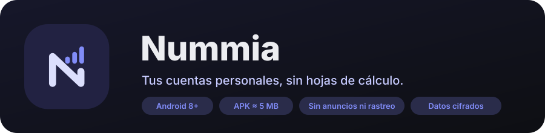
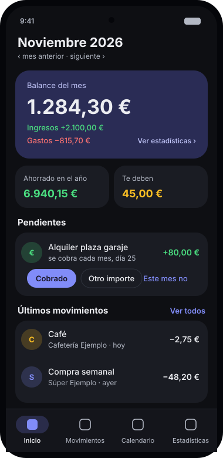
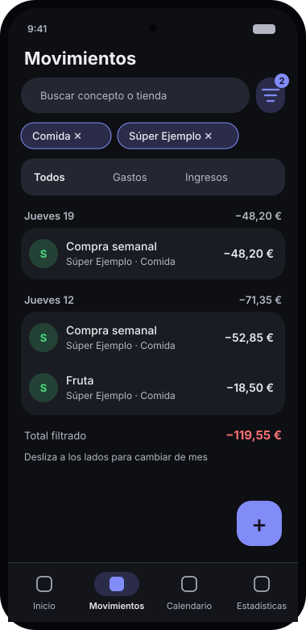
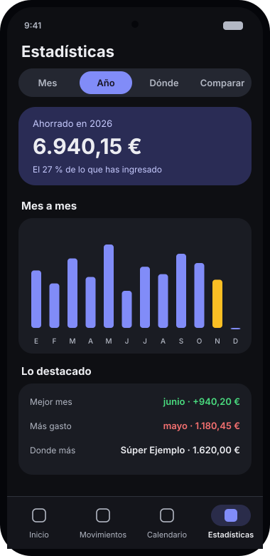
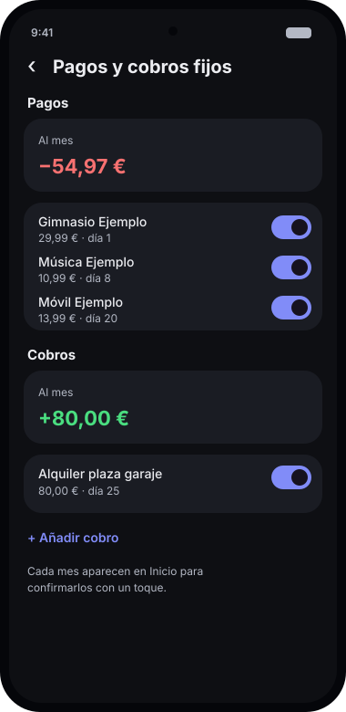

<p align="center">
  
</p>

<p align="center">
  <a href="https://github.com/alexcorrea2001-Lemon/Nummia/releases/latest"><b>⬇ Descargar la última versión</b></a> ·
  <a href="CHANGELOG.md">Novedades</a> ·
  <a href="docs/privacidad.md">Privacidad</a>
</p>

**Nummia** es una app Android para apuntar gastos, ingresos, sueldos y devoluciones, y saber de verdad cuánto gastas y cuánto ahorras. Sin servidores, sin anuncios y sin rastreo: tus datos están en tu móvil y, si quieres, en tu propio Google Drive.

<p align="center">
  
  
  
  
</p>
<p align="center"><sub>Ilustraciones de la app con datos inventados.</sub></p>

## Qué hace

### Apuntar en segundos
- **Gastos e ingresos** (sueldo, extras, ventas, trabajos extra…) con un **teclado propio** para el importe que también suma y resta: escribe `12+3,50` y se apunta `15,50 €`.
- **Categoría automática**: si una tienda ya tiene categoría, el gasto nuevo la toma solo. Hay 33 iconos y los colores que quieras, y las categorías se ordenan arrastrando.
- **Pagos y cobros fijos**: activa «Se paga cada mes» o «Se cobra cada mes» y cada mes aparecen en Inicio para confirmarlos con un toque, poner otro importe o saltarlos ese mes.
- **Sueldo previsto** a final de mes, que confirmas con el día y el importe reales.
- **Atajos**: botón «Nuevo gasto» en los Ajustes rápidos, accesos directos al mantener pulsado el icono y **widget** con el balance del mes.
- **✓ animado** al guardar y **Deshacer** al editar o borrar.

### Devoluciones y lo que te deben
- **Varias devoluciones por gasto**, aunque te devuelvan más de lo que pagaste.
- **Pago para otra persona**: marcas «me lo devuelven» y Nummia te lo recuerda en **Te deben**, agrupado por persona, con «Me lo ha pagado todo».

### Ver y entender tu dinero
- **Inicio**: balance del mes animado, lo ahorrado en el año, lo pendiente y lo último. En tablets y plegables, en dos columnas.
- **Movimientos**: buscador (sin importar las tildes, también por fecha: «marzo de 2026»), **filtros por categoría, tienda o persona**, importe y orden. Puedes elegir varios a la vez para borrarlos o cambiarles la categoría.
- **Calendario** con lo gastado cada día y **«Ir a…»** para saltar a cualquier mes al momento.
- **Estadísticas**: el mes, el año mes a mes con lo destacado, dónde gastas más y comparar años.
- **Ficha de cada tienda**: cuánto llevas, cuántas veces, la media y los últimos gastos.
- **Presupuestos** al mes en total, por categoría o por tienda, con aviso al 80 % y al 100 %.
- **Informes en PDF o Excel** con vista previa dentro de la app, para compartir o guardar en tu Drive.

### Tus datos, siempre tuyos
- **Base de datos cifrada** y **bloqueo** con huella, cara o PIN.
- **Modo discreto**: oculta los importes. Para verlos un momento, mantén pulsado el balance y pon tu huella.
- **Tu Drive**: sincroniza con una hoja de cálculo en tu propio Google Drive que puedes editar desde el ordenador. Nummia te dice qué llegó del ordenador en cada sincronización y guarda copias de seguridad diarias.
- **Importar tu Excel** de cuentas, **exportar todo a CSV**, **copia en archivo** `.nummia` y **papelera** de 30 días.
- Si no tienes Drive conectado, **una vez al mes te recuerda** hacer una copia.

### A tu gusto
- Temas claro, oscuro y **negro AMOLED**; 12 colores, uno personalizado o los de tu fondo de pantalla.
- 3 iconos de la app en 12 colores, **forma de las tarjetas**, **listas compactas** y **vibración** sí o no.
- Notificaciones opcionales con botones para **confirmar un pago o el sueldo** sin abrir la app.

### Ligera y rápida
- **APK de unos 5 MB**, arranque rápido y animaciones con efecto muelle que respetan «Quitar animaciones».
- **Sin servicios en segundo plano**: los avisos se revisan una vez al día y la sincronización solo cuando hace falta.
- **Se actualiza sola** desde GitHub (por defecto solo con Wi-Fi), comprobando la huella SHA-256 y la firma.

## Instalar

1. Abre [la última versión](https://github.com/alexcorrea2001-Lemon/Nummia/releases/latest) desde tu móvil Android (8.0 o posterior).
2. Descarga el archivo `nummia-vX.Y.Z.apk`.
3. Ábrelo y permite instalar apps de esa fuente si Android te lo pide.

Las siguientes versiones se instalan desde la propia app: **Ajustes → Acerca de → Buscar actualizaciones**.

## Privacidad

Lee la [política de privacidad](docs/privacidad.md). En resumen, tus datos solo están en tu móvil y, si lo conectas, en tu propio Google Drive. Nummia no tiene servidores, ni anuncios, ni analítica.

## Compilar tu propia copia

Necesitas Android Studio o JDK 17 y el SDK de Android.

```bash
./gradlew assembleDebug
```

El APK queda en `app/build/outputs/apk/debug/`. Para la versión firmada, define las variables de entorno `NUMMIA_KEYSTORE_PATH`, `NUMMIA_KEYSTORE_PASSWORD`, `NUMMIA_KEY_ALIAS` y `NUMMIA_KEY_PASSWORD` y ejecuta `./gradlew assembleRelease`. **Nunca subas tu keystore ni sus contraseñas al repositorio.**

Para usar Google Drive en tu propia copia necesitas tu propio proyecto de Google Cloud, con las API de Drive y Sheets activadas y un ID de cliente OAuth de Android para tu nombre de paquete y tu firma.

**Hecha con** Kotlin, Jetpack Compose (Material 3), Room con SQLCipher, Hilt y WorkManager.

## Documentación del proyecto

- [Diseño](docs/superpowers/specs/2026-11-20-nummia-design.md)
- [Novedades](CHANGELOG.md)

## Licencia

[MIT](LICENSE)
